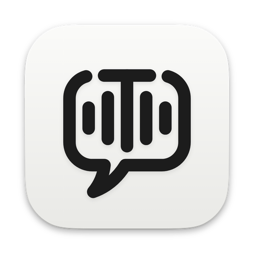
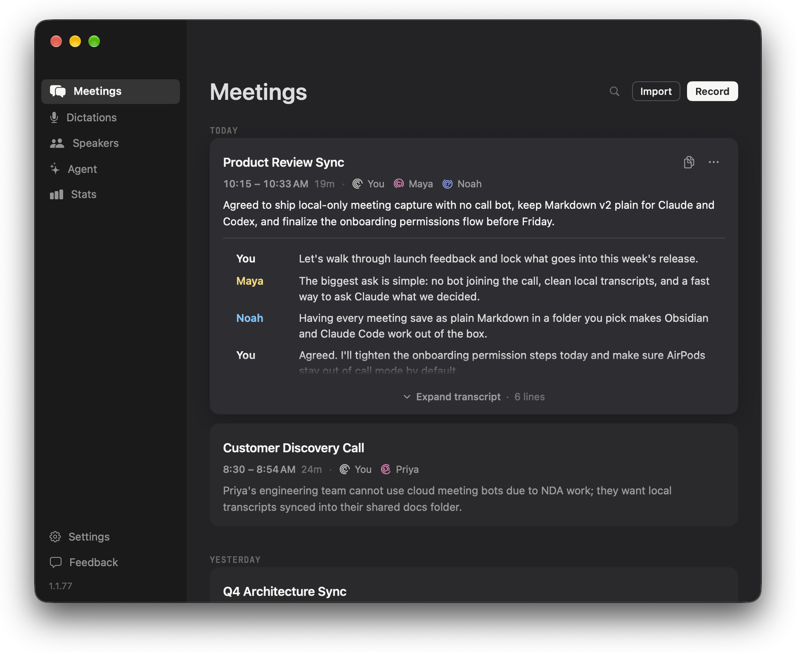
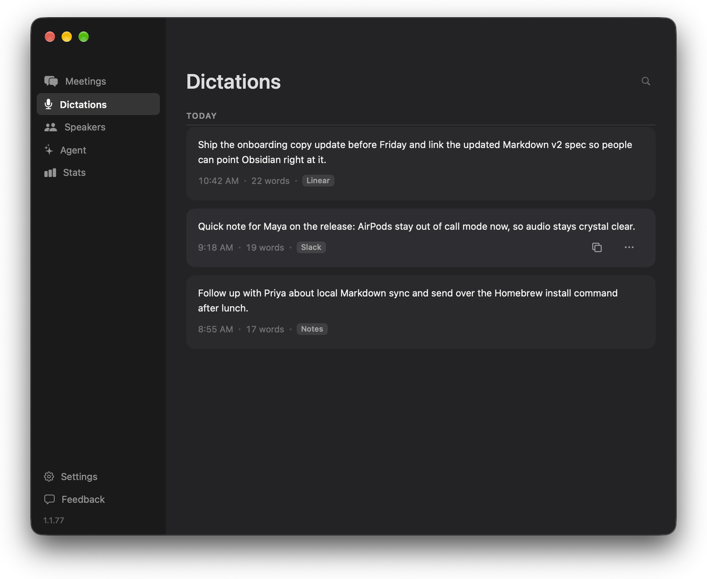
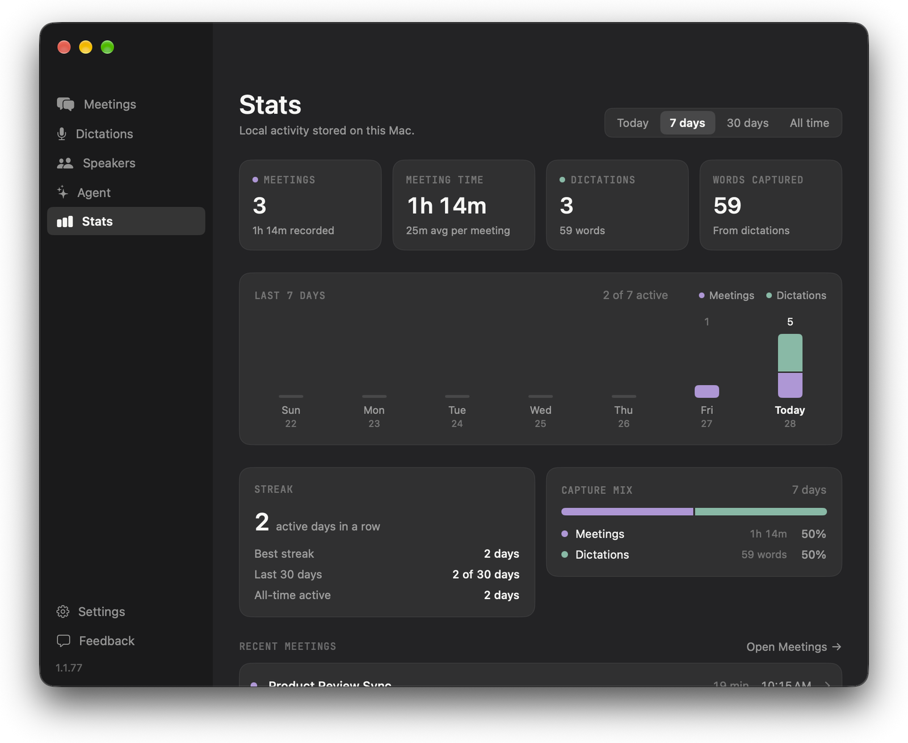
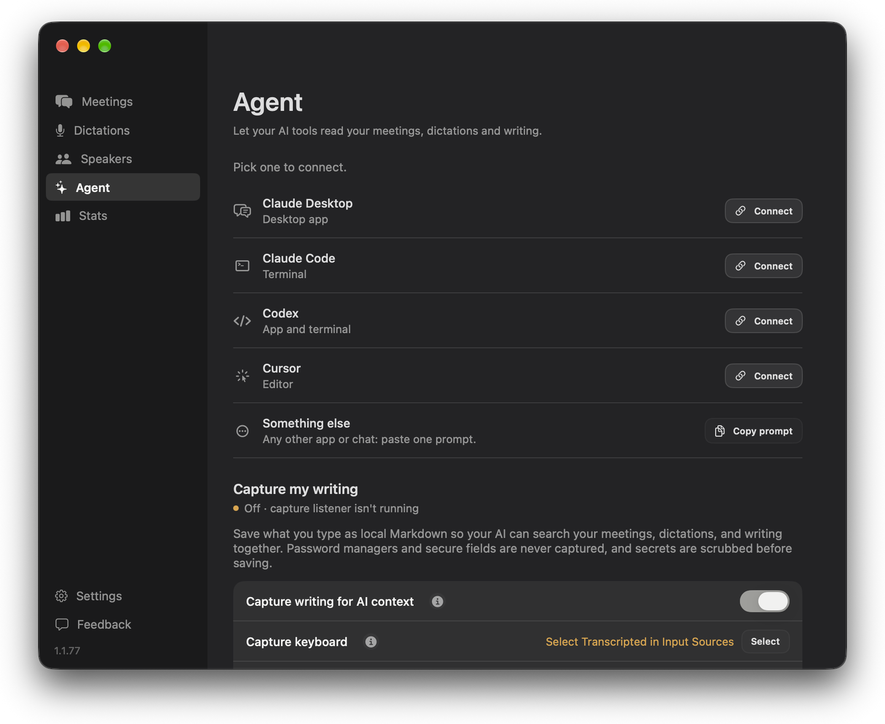

<p align="center">
  <picture>
    <source media="(prefers-color-scheme: dark)" srcset="docs/assets/app-icon-options/website/icon-dark.png">
    
  </picture>
</p>

<h1 align="center">Transcripted</h1>

<h3 align="center">Private meeting notes and dictation that never leave your Mac. No bot joins your call.</h3>

<p align="center">
  Transcripted is a free, open-source macOS app that records meetings and dictation locally on your Mac<br>
  and saves plain Markdown files you own — ready for Obsidian, Claude, Codex, or any AI tool.
</p>

<p align="center">
  <a href="https://transcripted.app/download"><picture>
    <source media="(prefers-color-scheme: dark)" srcset="https://img.shields.io/badge/Download_for_macOS-f5f5f7?style=for-the-badge&logo=apple&logoColor=black">
    
  </picture></a>
</p>

<p align="center">
  <a href="#install">Install with Homebrew</a> ·
  <a href="https://transcripted.app/#try">Interactive demo</a> ·
  <a href="https://transcripted.app">transcripted.app</a> ·
  <a href="https://github.com/r3dbars/transcripted/discussions">Discussions</a>
</p>

<p align="center">
  <a href="https://github.com/r3dbars/transcripted/releases/latest"></a>
  <a href="#install"></a>
  <a href="LICENSE"></a>
</p>

<p align="center">
  
</p>

## What it does

- **Records any meeting — no bot.** Works with Zoom, Google Meet, Teams, FaceTime, Slack huddles, or in-person conversations. Captures your mic and system audio locally, so nothing joins your call.
- **Notices when a call starts.** Offers to start recording when a call begins, and can remind you before meetings on your calendar.
- **Knows who's talking.** Splits calls by speaker and uses call-app speaker hints to speed up naming. Name someone once and Transcripted suggests them next time. For in-person meetings, turn on **People in the room** under **Settings → Advanced → Meetings**.
- **Click any line to hear it back.** Meetings expand in place with retained audio playback, speed controls, and track isolation.
- **Optional on-device titles & summaries.** Turn on **Titles and summaries** in Settings to generate a title, takeaway, and short summary locally on your Mac—no cloud API required.
- **Dictate anywhere with one key.** Hold **Right Option** to talk (or tap to keep listening, tap again to paste). Your words land right where you were typing, and audio stays available for 30 days so you can replay or re-transcribe a take.
- **AirPods-safe by default.** Automatically uses your Mac's microphone when you're on AirPods so your headphones don't drop into garbled call mode.
- **Transcribes audio and video files.** Drop in recordings from the Meetings page or run the bundled command-line tool.

Everything runs locally on your Mac. The default speech and speaker models ship inside the app, so transcription works completely offline.

<p align="center">
  
  
</p>

## Your notes are plain files

Every meeting becomes a clean Markdown file with frontmatter, optional on-device summary, timestamps, and speaker names:

```md
---
title: "Product Review Sync"
capture_type: meeting
format_version: 2
transcript_style: styled
date: 2026-11-28
duration: "18:42"
total_word_count: 1864
---

# Product Review Sync

Recorded Nov 28, 2026 at 10:15 AM  •  18 min, 42 sec  •  1864 words  •  6 turns

## Summary

Agreed to ship local-only meeting capture with no call bot, keep Markdown v2 plain for Claude and Codex, and finalize the onboarding permissions flow before Friday.

## Transcript

[00:00] **You:** Let's walk through launch feedback and lock what goes into this week's release.

[00:18] **Maya:** The biggest ask is simple: no bot joining the call, clean local transcripts, and a fast way to ask Claude what we decided.
```

By default, your notes live in:

```text
~/Library/Application Support/Transcripted/captures/
```

Want them inside an Obsidian vault or another folder? Change **Settings → Library → Folder** and Transcripted can move existing files for you. Full spec: [docs/capture-format.md](docs/capture-format.md).

## Ask your AI

Because everything is saved as plain Markdown, any AI tool that reads files—or supports MCP—can search and quote your meetings and dictations.

```text
You:    What did I commit to in the product review?

Claude: From Product Review Sync (Nov 28):
        • Tighten the onboarding permission steps today (02:10)
        • Make sure AirPods stay out of call mode by default (02:10)
        Maya also offered to share the updated checklist in Linear before standup (03:25).
```

Open **Agent** in the sidebar and click **Connect** next to **Claude Desktop**, **Claude Code**, **Codex**, or **Cursor**. That wires up Transcripted's local, read-only MCP server—your AI can search and read your notes, but can't modify or delete anything. For any other AI app, click **Copy prompt** on the **Something else** row.

If you also want your AI to search what you type across apps, you can opt into **Capture my writing** on the **Agent** page (off by default; password managers and secure fields are skipped, and secrets are scrubbed before saving). Setup details: [docs/agent-connect.md](docs/agent-connect.md).

<p align="center">
  
</p>

## Install

**Requirements:** Apple Silicon Mac (M1 or later) · macOS 26 Tahoe or later · ~700 MB download (speech models included) · No account required.

### Direct download

1. [Download Transcripted](https://transcripted.app/download) — signed, Apple-notarized, and auto-updating via Sparkle.
2. Open the DMG and drag **Transcripted** to **Applications**.

### Homebrew

```bash
brew tap r3dbars/transcripted https://github.com/r3dbars/transcripted
brew install --cask transcripted
```

### First launch & permissions

Transcripted only asks for the macOS permissions needed for what you use:

- **Dictation:** Microphone + Accessibility (for shortcuts and pasting into apps)
- **Meetings:** adds System Audio Recording (to capture the other side of calls)
- **Meeting reminders (optional):** Calendar

Once open:
- **Record a meeting:** Click the menu bar icon and choose **Record** (or accept the call-detection prompt).
- **Dictate:** Hold **Right Option** and speak, or tap once to keep listening and tap again to paste.

> Turning on optional on-device **Titles and summaries** in Settings downloads a 3.1 GB local model once and runs it entirely on your Mac.

## Privacy

- **Local by default.** Your audio, transcripts, and voice profiles never leave your Mac.
- **Retained audio stays under your control.** Meeting audio is kept so you can replay any line (set auto-delete to 7 days, 30 days, or Forever in **Settings → Library**). Dictation audio is kept for 30 days by default (set to Don't keep, 7 days, 30 days, or Forever). Deleting audio never deletes your Markdown transcripts.
- **Optional Capture my writing** is off by default. Password managers and secure fields are never captured, secrets are scrubbed locally before saving, and nothing you type is ever sent off-device.
- **Anonymous diagnostics.** Crash reports (Sentry) and anonymous usage stats (PostHog) are on by default and can be turned off with one switch in **Settings → Privacy**. They never include audio, transcripts, meeting titles, speaker names, typed text, or file paths. See the full [privacy contract](docs/privacy-first-observability.md#privacy-contract).
- **Connected cloud AIs.** If you connect Claude, Codex, or another cloud AI, the notes you ask it to read go to that provider. Transcripted itself never uploads them.

Full storage layout: [docs/storage-paths.md](docs/storage-paths.md).

## FAQ

**How is it different from Otter, Fireflies, or Granola?**
Otter and Fireflies join your calls with a bot and store your meetings in their cloud. Granola skips the bot, but your meetings still go to their servers. Transcripted transcribes everything locally on your Mac as plain Markdown, and it's free and open source. More comparisons (including MacWhisper and Meetily): [transcripted.app/compare](https://transcripted.app/compare).

**Does it write summaries?**
Yes, if you want it to. By default Transcripted saves the full transcript and lets you ask your connected AI for summaries, decisions, or action items. If you want automatic summaries built in, turn on **Titles and summaries** in Settings—it downloads a 3.1 GB local model and generates titles and summaries completely on-device.

**Does it work offline?**
Yes. Recording, transcription, speaker labeling, and on-device summaries work with no internet connection. The app only goes online to check for updates, download optional models, and send anonymous crash/usage telemetry (if enabled).

**What languages does it understand?**
The default **Parakeet V3** model covers 25 European languages, including English. For other languages, switch to **Whisper Large V3 Turbo** under **Settings → Advanced → Transcription**—it downloads once and runs locally too.

**How accurate is it?**
Strong enough for daily notes and AI search, though uncommon names and jargon can still slip. Add persistent fixes under **Settings → Advanced → Transcription → Corrections** (for example, `"okay ours"` → `"OKRs"`).

**Do people know I'm recording?**
Only if you tell them. There's no meeting bot, so Transcripted does not notify other participants. Always get consent before recording where required by law or courtesy.

**What does it cost?**
Nothing. Free, MIT-licensed open source—no account, no subscription.

**Is there a command-line tool?**
Yes, `transcripted-cli` ships right inside the app bundle. See [Tools/TranscriptedCLI/README.md](Tools/TranscriptedCLI/README.md).

<details>
<summary><strong>Uninstall</strong></summary>

1. Quit Transcripted from the menu bar.
2. Drag Transcripted out of **Applications**, or run `brew uninstall --cask transcripted`.
3. If you enabled **Capture my writing**, also remove Transcripted under **System Settings → Keyboard → Input Sources** and delete `~/Library/Input Methods/Transcripted Keyboard.app` if present.

Your saved meetings and dictations stay untouched. To delete all local app state, models, and voice profiles (plus your notes if they're still in the default folder), remove `~/Library/Application Support/Transcripted/`.

</details>

## Build and contribute

Transcripted is a native Swift macOS app. Building from source requires an Apple Silicon Mac on macOS 26+ with Xcode 26+.

```bash
bash build-deps.sh
bash build.sh --no-open
bash run-tests.sh
```

- Contributors: [CONTRIBUTING.md](CONTRIBUTING.md)
- Questions & ideas: [GitHub Discussions](https://github.com/r3dbars/transcripted/discussions)
- Coding agents: [AGENTS.md](AGENTS.md)
- Security reports: [SECURITY.md](SECURITY.md)

If Transcripted is useful to you, giving the repo a star helps other Mac users find it.

## License

MIT. See [LICENSE](LICENSE). Bundled third-party components are listed in [THIRD_PARTY_LICENSES.md](THIRD_PARTY_LICENSES.md).
